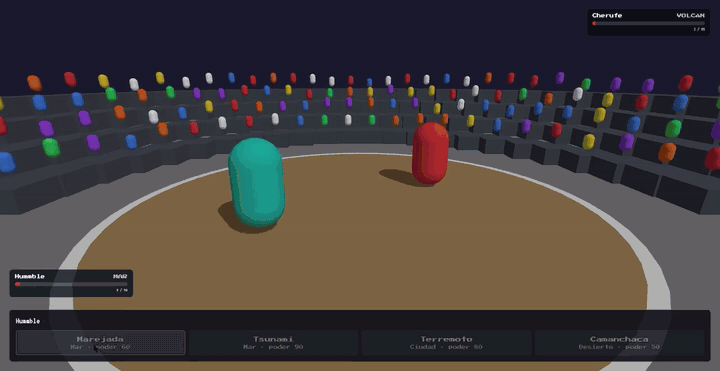

# Fin del Mundo

*Leyendas de Norte a Sur*



## Descripción

Juego de combate por turnos diario en el navegador: criaturas inspiradas en la fauna chilena, un equipo al azar cada día y un solo intento para derrotar a Lautaro. Hecho con three.js y Vite.

## Jugar

[Juega aquí](https://dark0glow0.github.io/fin-del-mundo/)

## Cómo se juega

- Cada día recibes tres criaturas al azar.
- Eliges el orden en que saldrán tus criaturas a pelear.
- El combate va por turnos. Eliges un ataque y la criatura más rápida ataca primero.
- Tienes un intento diario para derrotar a Lautaro.

### Tipos

| Tipo | Fuerte contra |
|---|---|
| Mar | Volcán, Desierto |
| Bosque | Mar, Cordillera |
| Volcán | Hielo, Bosque |
| Cordillera | Volcán, Desierto |
| Desierto | Hielo, Bosque |
| Hielo | Mar, Cordillera |
| Ciudad | Neutral |

- **Fuerte contra**: el ataque hace el doble de daño (x2).
- **Débil contra** (el defensor es fuerte contra el tipo del ataque): hace la mitad del daño (x0.5).
- **Mismo tipo**: si la criatura usa un ataque de su propio tipo, hace un 50% de daño extra (x1.5).

## Herramientas

- **three.js**: librería 3D para la escena, la cámara, las luces y sombras, las criaturas, el estadio y los efectos de los ataques, todo con sus respectivas animaciones.
- **Vite**: servidor de desarrollo y empaquetado del juego para publicarlo.
- **JavaScript**: lenguaje de programación que le da la lógica al juego: combate por turnos, cálculo de daño, tipos de criaturas y sus ventajas, equipo e intento diarios y la lógica de la interfaz.
- **HTML y CSS**: estilo y estructura de la interfaz del juego: pantallas, paneles y botones, con fuentes 8-bit para darle estilo retro.
- **Web Audio API**: herramienta para controlar y generar sonido dentro del navegador: música en loop sin cortes, murmullo del público, sonidos sintéticos y la pausa del audio al cambiar de pestaña.
- **localStorage**: herramienta del navegador para guardar la información de la partida en curso y el resultado del día, para continuar la pelea al recargar la página y permitir un solo intento diario.
- **GitHub Pages + Actions**: hosting público del juego para su publicación y automatización de acciones en cada push.

## Ejecutar en local

Requiere [Node.js](https://nodejs.org/).

​```bash
git clone https://github.com/Dark0Glow0/fin-del-mundo.git
cd fin-del-mundo
npm install
npm run dev
​```

Luego abre http://localhost:5173 en el navegador.

## Créditos y licencia

### Sonidos

| Sonido original | Archivo | Uso en el juego | Autor | Licencia |
|---|---|---|---|---|
| [Fast fight / battle music](https://opengameart.org/content/fast-fight-battle-music) | pelea.ogg | Música de combate | Ville Nousiainen (mutkanto) | CC0 |
| [Crowd Cheers](https://pixabay.com/es/sound-effects/gente-crowd-cheers-314921/) | gano_jugador.mp3 | Victoria | storegraphic | Licencia de Pixabay |
| [Crowd Disappointment Reaction](https://pixabay.com/es/sound-effects/gente-crowd-disappointment-reaction-352718/) | fallo_ataque.mp3 | Reacción del público al fallar un ataque | Universfield | Licencia de Pixabay |
| [Crowd Large Outrage Then Booing Reaction (Hockey Game 2011)](https://pixabay.com/es/sound-effects/gente-crowd-large-outrage-then-booing-reaction-hockey-game-2011-25915/) | abucheo.mp3 | Derrota | freesound_community | Licencia de Pixabay |
| [Stadium Crowd Whistle](https://budgetpixel.com/sfx/stadium-crowd-whistle-077f5fb7) | publico_ola.mp3 | Reacción del público al acertar un ataque | BudgetPixel AI | CC BY 4.0 (modificado: sin silbato) |
| [Stadium Goal Roar](https://budgetpixel.com/sfx/stadium-goal-roar-75bcfd89) | publico_loco.mp3 | Reacción del público a golpes críticos y aparición de criaturas | BudgetPixel AI | CC BY 4.0 (recortado) |
| [Frost Spell Impact](https://pixabay.com/es/sound-effects/pel%C3%ADculas-y-efectos-especiales-frost-spell-impact-499662/) | hielo.mp3 | Impacto de ataques tipo Hielo | Dragon Studio | Licencia de Pixabay |
| [Wood Crack 2](https://pixabay.com/es/sound-effects/naturaleza-wood-crack-2-493328/) | bosque.mp3 | Impacto de ataques tipo Bosque | nematoki | Licencia de Pixabay |
| [Water Splash](https://pixabay.com/es/sound-effects/pel%C3%ADculas-y-efectos-especiales-water-splash-199583/) | mar.mp3 | Impacto de ataques tipo Mar | Universfield | Licencia de Pixabay |
| [Lava splash](https://opengameart.org/content/lava-splash) | volcan.mp3 | Impacto de ataques tipo Volcán | Michel Baradari | CC BY 3.0 (recortado) |
| [Desert Wind 1](https://pixabay.com/es/sound-effects/naturaleza-desert-wind-1-350398/) | desierto.mp3 | Impacto de ataques tipo Desierto | tanweraman | Licencia de Pixabay |
| [Designed Rocks Sequences 02](https://pixabay.com/es/sound-effects/pel%C3%ADculas-y-efectos-especiales-designed-rocks-sequences-02-117382/) | cordillera.mp3 | Impacto de ataques tipo Cordillera | gregorquendel | Licencia de Pixabay |
| [Digging](https://pixabay.com/es/sound-effects/pel%C3%ADculas-y-efectos-especiales-digging-6691/) | ciudad.mp3 | Impacto del ataque Terremoto | freesound_community | Licencia de Pixabay |
| [Bus Arrival](https://pixabay.com/es/sound-effects/ciudad-bus-arrival-71991/) | microllena.mp3 | Impacto del ataque Micro Llena | freesound_community | Licencia de Pixabay |
| [UI Pop Up Open](https://pixabay.com/es/sound-effects/pel%C3%ADculas-y-efectos-especiales-ui-pop-up-open-634801/) | entrada.mp3 | Entrada de las criaturas a la batalla | chisper | Licencia de Pixabay |
| [UI Pop Up Open](https://pixabay.com/es/sound-effects/pel%C3%ADculas-y-efectos-especiales-ui-pop-up-open-634801/) | retirada.mp3 | Derrota de las criaturas (sonido invertido) | chisper | Licencia de Pixabay |

Todos los sonidos fueron recortados y normalizados en volumen para el juego. Los efectos de BudgetPixel fueron generados con IA.

### Licencia

El código está bajo la licencia [MIT](https://github.com/Dark0Glow0/fin-del-mundo/blob/main/LICENSE). Los sonidos tienen sus propias licencias, indicadas en la tabla de sonidos.

## Autor

Benjamin Bravo · [Portafolio](https://dark0glow0.github.io/Portafolio/) · [GitHub](https://github.com/Dark0Glow0)
